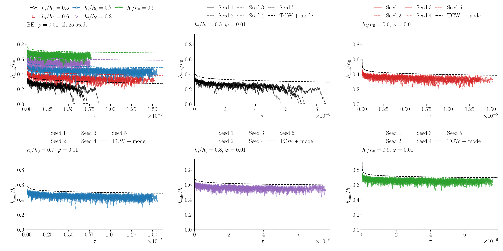
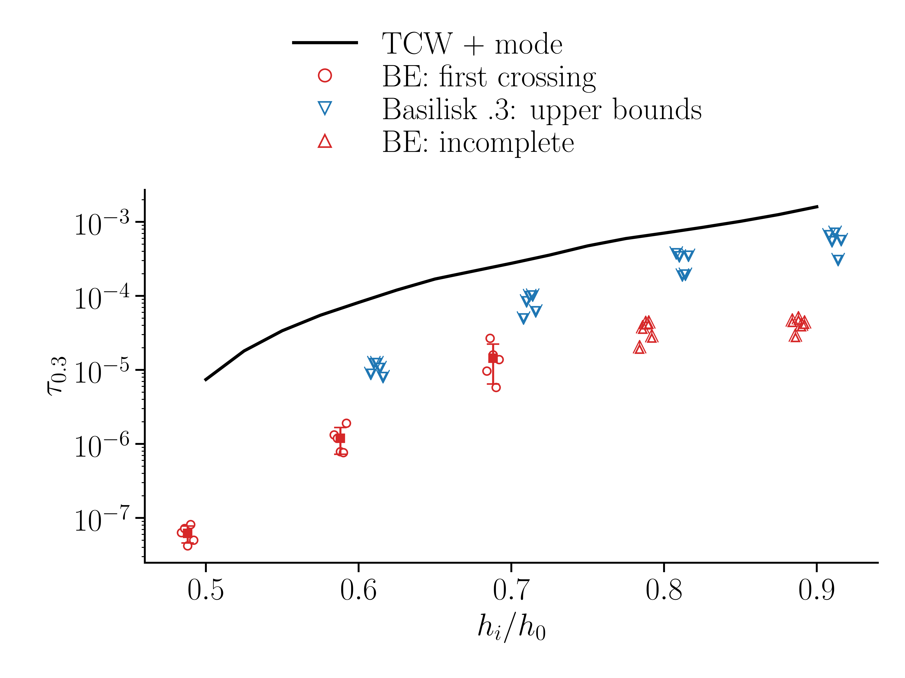
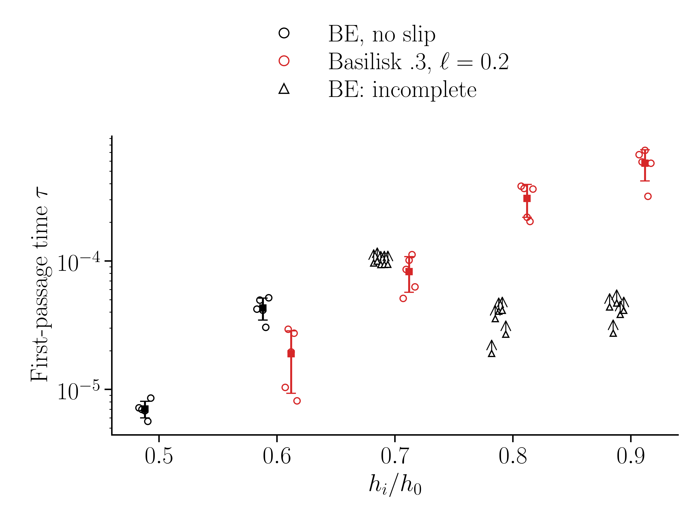

# 附壁液膜：厚度依赖迁移率的 BE / 多重网格计算

当前版本计算无滑移固壁上的二维高度场 `h(x,y,τ)`，对应三维液膜自由表面。迁移率随局部厚度变化为 `m(h)=h³`，含吸引性范德华力和保守白噪声通量。时间推进使用随机后向欧拉（BE），通过 Basilisk 多重网格及外层非线性迭代求解。

## 当前25条独立轨迹

| 项目 | 设置 |
|---|---|
| 初始厚度 `h_i/h_0` | 0.5、0.6、0.7、0.8、0.9，各5个独立种子 |
| 网格、噪声 | 64²周期计算网格；white6，即64²独立面白噪声 |
| 噪声强度、滑移 | φ=0.01；无滑移 |
| 归一化 | 盒长1，`A=4π²/3`，`m=h³`；`h_0`是固定参考厚度 |
| 时间 | `τ=t_previous/(3×128⁴)=t_previous/805306368` |
| 停止条件 | 正有限厚度首次跨到 `hmin/h_0≤0.005`，保存时间括区与前后厚度 |
| 每条资源 | 4物理OpenMP核；6小时资源窗口，检查点续排 |
| 完整更新残差、质量误差 | `<1e-8`、`<1e-9`；不裁剪厚度、不补质量、不重抽拒步噪声 |

[完整工况与种子](campaign.json) · [状态CSV](dashboard/status.csv) · [看板HTML](dashboard/index.html) · [验证结果和来源SHA](dashboard/data.json)



看板保留每个厚度的全部5条轨迹，不将未到阈值的轨迹计为破碎时间。虚线为每个厚度唯一的 TCW+mode：沿用 `C_rms=3.5`、white6连续谱传递近似、固定256²求和截断及值/斜率连续拼接；不随种子重算或拟合。256²是理论求和设置，计算网格仍是64²。

方形末点表示尚在计算，空心圆表示实际保存的停止阈值，叉表示数值停止。图仅画到核验的保存检查点；刷新时间写在看板内。hmin=0.3的短暂下穿与最终停止阈值0.005不同。

### 以首次到0.3为破碎：TCW+mode vs 数值轨迹



[到0.3的统计及定义](dashboard/h03_comparison.md) · [hmin曲线：首次到0.3即截断](dashboard/hmin_first_h03.png) · [BE逐条事件](dashboard/BE_h03_events.csv)

本节按用户新判据，将首次 `hmin/h_0≤0.3` 定义为统计破碎，即使此后回升也计入。红色BE事件来自完整接受步历史；蓝色旧Basilisk数据每300个原生时间才保存一次，只能提供首次下穿时间的上界。黑线保持固定 `C_rms=3.5` 的TCW+mode包络交点，不拟合轨迹，也不将其解释为严格的随机首达平均。

0.5组在TCW分支上已到0.3，该交点直接求TCW分支的根；其余组在拼接后的mode分支到0.3。运行端仍保存至原0.005目标以分析后续演化；以下原统计保留。

### 原0.005停止事件与 Basilisk .3 的比较



[逐条已完成事件](dashboard/completed_events.csv) · [样本统计与说明](dashboard/event_comparison.md) · [旧批次参考及来源](reference/provenance.json)

事件图统一为初始厚度的1%阈值，即 `hmin/h_0=.01*(h_i/h_0)`；从BE完整历史提取首次下穿及其接受步括区。本批次仍算到固定阈值0.005后才停止。方块与误差棒为5条事件的均值±样本SD，三角与向上箭头为尚未到阈值的观察下界。旧Basilisk .3批次没有0.5组，不用其他算例替代。

## 方程与离散

```math
\partial_\tau h=\nabla\cdot\left[h^3\nabla\left(-\nabla^2h+A h^{-3}\right)+\sqrt{2\varphi h^3}\,\boldsymbol\xi\right],\qquad A=4\pi^2/3.
```

网格上使用算术面厚度。毛细压力作中心差分；吸引项保留旧多重网格程序的面中点链式近似 `-3A/h_face × grad(h)`。它在平膜线性化时与直接化学势差一致，强梯度下并不完全相同，不能据此声称复现旧化学势差求解器的破碎时间。

BE 在每步末态计算确定性通量与乘性噪声通量，外层线性化的噪声导数与 `sqrt(2φ) h_face^(3/2)`一致。拒步时沿同一 Brownian bridge 细分；不更换底层随机路径。内部多重网格方程残差因时间换算乘805306368；最终物理更新残差和质量门槛不变。

## 先验证，再启动每个厚度的5条轨迹

每个厚度先检查：噪声通量及其厚度导数；x/y转置对称；一个增长模与一个衰减模的离散BE模态率；两条独立噪声路径、64个共同保存时刻的步长对照；检查点重放。

短测以 `2.1e-9/64` 为细步参考，依次筛查除数8、16、32。最大场RMS相对差须≤2%，最大hmin差须≤0.005；通过后对应5条轨迹才提交。质量、残差和正厚度接受门槛始终相同。通过结果见 [validation](validation/README.md)。这是有限时间强误差筛查，**不代表长期平衡或首达时间统计已收敛**。

初版正则模检查对0.8、0.9推进过久，振幅衰减到约1e-11，低于高度迭代容差，拟合失败。新版在可分辨振幅窗口测量，保留相同2%误差门槛；初版失败证据单独保留。

## 方法版本的区别

| 版本 | 迁移率与噪声 | 时间推进与求解 | 位置 |
|---|---|---|---|
| 本版 BE / MG | 局部 `h³`；保守乘性面噪声 | 末态随机BE；Basilisk MG + 非线性外迭代 | [be](be/) |
| 本版之前的0.7 BE试跑 | 同样局部 `h³`；φ=0.01 | 同一BE内核；固定初厚0.7、独立种子61101 | [试跑与换单位检查归档](archives/be_pilot_and_checks_20261119.zip) |
| 原仓库 JAM / C-FFT | 冻结于初态的迁移率；加性噪声 | 隐式中点；Python Fourier或C FFT固定点求解 | [旧代码归档](archives/legacy_code_20261119.zip) |
| 原仓库正则模、TCW验证 | 对应上行冻结迁移率程序 | 旧程序自身的Python/C对照 | [旧验证归档](archives/legacy_validation_20261119.zip) |
| 旧截图 Basilisk .3 | 局部 `h³+0.2h²`，φ=0.01 | 随机中点、Newton–GMRES和FFT预条件；16MPI | 外部历史对照，不是本仓库旧FFT验证，也不是本版BE |

`.3`是旧程序的原生最大时间步，不是hmin阈值。对初厚0.7，旧 Basilisk .3 的共同单位为 `h=.7 H_old`、`τ=.7 t_old/1e8`。旧有滑移、本版无滑移，离散与核心数也不同；统一单位后仍不能直接解释为同条件算法速度比。

旧验证只支持它实际运行的方法。归档旧验证不等于本版BE已通过同样的长期谱或首达检验。

## 重跑与更新看板

依赖 Python、NumPy、SciPy；绘图另需 Matplotlib、Pillow 和真实 LaTeX 工具链。Linux 上用安装好的 Basilisk 编译：

```bash
cd be
export BASILISK=/path/to/basilisk/src
bash build.sh
cd ..
mkdir -p runs/current
cp be/wall_native.so runs/current/
cp sites.example.json runs/current/sites.json
# 编辑 sites.json 为自己有权限的服务器、Python与Basilisk路径。
python cluster.py --workspace runs/current prepare
python cluster.py --workspace runs/current watch
```

调度器先投SIPF；确实排队时才投XH与WUZH。精确路由记录在工作目录的candidates/selected回执中；有一个副本运行后，取消其他副本、校验其归档再清理。只处理本批次登记的作业目录。验证失败的厚度不提交生产，不自动放宽门槛。数值失败保存后停止；6小时资源窗结束通过原参数检查点续排。

```bash
python collect.py --workspace runs/current
python render.py --workspace runs/current
python compare_events.py --workspace runs/current
python compare_h03.py --workspace runs/current
python be/tcw_mode.py  # 重现已登记的0.7 TCW参考交点
```

原始场、检查点和完整历史保留在运行端/本地，不上传新的原始场到GitHub。公开看板包含绘图抽样、参数、统计及来源SHA。图按时间分箱保留首末及极值，不平滑。每张独立图8×6英寸、20pt真实LaTeX、PDF和600dpi PNG；总览拼图用于浏览。

## 归档与恢复

本次改版以提交 `c3267936502517be6ac3d963781844d3561c01ae` 为基础。旧代码、原README、Notebook及本地既有补充代码装入代码ZIP；已经公开的旧验证数据、图像和动画装入验证ZIP。将两个ZIP解压到同一目录即可恢复原布局。本地原工作树没有删除或覆盖。[逐文件SHA与归档SHA](archives/manifest.json)。新增BE试跑检查另有独立归档。
