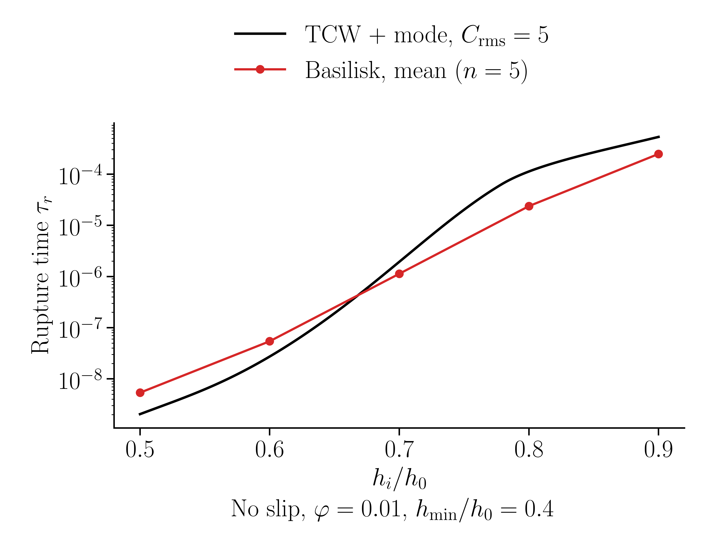

# 附壁液膜破碎

无滑移固壁上的随机润滑模型：二维周期高度场，对应三维液膜自由表面，局部迁移率m=h³。仓库保留两套当前求解器与一张结果对比图。

## 结果：破碎时间与初始厚度

黑线：TCW+mode，C_rms=5。红线：无滑移Basilisk随机中点数值结果，每个初始厚度5条独立轨迹的首达时间算术平均；连接线用于引导视线，不表示连续数值计算。

统一参数：φ=.01、64²周期网格、无排斥、无滑移；固定参考厚度判据hmin/h0=.4。横轴为初始厚度hi/h0=.5–.9，纵轴为共同无量纲时间τ_r。h0是固定参考厚度，不能将此判据改读为hmin/hi=.4。

数值事件使用接受步首次跨越括区的上端；逐条括区、轨迹和统计中间文件留在私有工作目录。图中是事件时间的平均，不是平均厚度曲线的终点，也不将5个样本称为收敛的平均首达时间估计。

[矢量PDF](results/rupture_time_vs_h0.pdf) · [600 dpi PNG](results/rupture_time_vs_h0.png)

## 当前代码

| 目录 | 方法 | 入口 |
|---|---|---|
| be/ | 随机后向欧拉；Basilisk多重网格和非线性迭代 | [说明](be/README.md) |
| basilisk_midpoint/ | 随机中点；Newton–GMRES，FFT预条件 | [说明](basilisk_midpoint/README.md) |
| tools/ | 两套调度器及本图绘制脚本 | [用法](tools/README.md) |
| config/ | 不含真实账号的站点模板 | [说明](config/README.md) |
| postprocess/ | 共享学术绘图样式 | [说明](postprocess/README.md) |
| results/ | 仅本页结果图的PDF和PNG | — |

BE的A=4π²/3；中点版A=13.159。BE吸引项采用面链式近似，中点版采用直接化学势差；两者时间方法和空间离散均有区别。本图数值线只使用中点版，没有混入BE、滑移历史批次或先导试跑。

`campaign.json`是BE工况模板；中点工况在`basilisk_midpoint/campaign.json`。配置文件中的参数和种子用于重现计算，不含轨迹、场或统计结果。运行端验证代码随各求解器保留；验证输出不在公开目录。

仓库main不保留原始场、完整历史、逐轨迹数据、旧看板、历史ZIP或验证结果数据。当前清理针对main文件树，未改写Git提交历史。服务器运行与本地研究数据不受影响。
