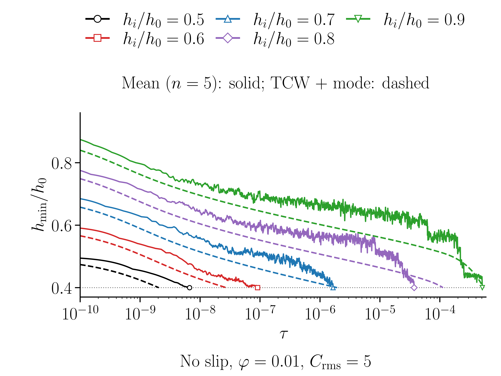

# Basilisk 无滑移 hmin 平均值看板

更新时间 UTC 2026-11-20T07:31:01.216894+00:00

64²、每条4 MPI核；φ=.01、m=u³、A=13.159、C_rms=5。实线为每个厚度5条路径的平均；虚线为64²连续Fourier谱TCW+mode，无白噪声插值滤波。固定绝对阈值u=h/h0=.4。

|工况|服务器|作业|类型|调度状态|u_min|tau|
|---|---|---|---|---|---:|---:|
|bm_v_h05|SIPF|65742|validation|COMPLETED|2026-11-19T17:49:32|node3|—|—|
|bm_v_h06|SIPF|65743|validation|COMPLETED|2026-11-19T17:49:32|node2|—|—|
|bm_v_h07|SIPF|65744|validation|COMPLETED|2026-11-19T17:49:32|node4|—|—|
|bm_v_h08|SIPF|65745|validation|COMPLETED|2026-11-19T17:49:32|node7|—|—|
|bm_v_h09|SIPF|65746|validation|COMPLETED|2026-11-19T17:49:32|node12|—|—|
|bm_h06_s1|SIPF|65747|production|COMPLETED|2026-11-19T17:51:32|node3|0.3999614155633407|5.351286474609375e-08|
|bm_h06_s2|SIPF|65748|production|COMPLETED|2026-11-19T17:51:32|node7|0.3999519452768233|5.9003337890624996e-08|
|bm_h06_s3|SIPF|65749|production|COMPLETED|2026-11-19T17:51:32|node12|0.39992474302936937|1.0898326171875e-08|
|bm_h06_s4|SIPF|65750|production|COMPLETED|2026-11-19T17:52:32|node3|0.39996871980062565|5.669472509765625e-08|
|bm_h06_s5|SIPF|65751|production|COMPLETED|2026-11-19T17:52:32|node7|0.39991639975069765|9.101876074218749e-08|
|bm_h08_s1|SIPF|65752|production|COMPLETED|2026-11-19T17:52:32|node12|0.3999013012906576|2.0175538035156252e-05|
|bm_h08_s2|SIPF|65753|production|COMPLETED|2026-11-19T17:53:32|node3|0.39982412723806654|2.9122944798828125e-05|
|bm_h08_s3|SIPF|65754|production|COMPLETED|2026-11-19T17:53:32|node7|0.3999418082669569|2.366203432421875e-05|
|bm_h08_s4|SIPF|65755|production|COMPLETED|2026-11-19T18:37:35|node7|0.3999552042958608|3.721999489648438e-05|
|bm_h08_s5|SIPF|65756|production|COMPLETED|2026-11-19T18:37:35|node7|0.399912669332363|8.435183275390627e-06|
|bm_h09_s1|SIPF|65757|production|COMPLETED|2026-11-19T18:40:35|node7|0.39975980760990815|0.00019753748635034182|
|bm_h05_s1|XH|25802237|production|COMPLETED|2026-11-19T18:42:21|b06r03n03|0.3999660287033404|5.247298583984375e-09|
|bm_h05_s2|XH|25802259|production|COMPLETED|2026-11-19T18:42:21|b07r01n03|0.3999027497652146|4.6295458984375e-09|
|bm_h05_s3|XH|25802260|production|COMPLETED|2026-11-19T18:42:21|b02r08n04|0.39995486411901693|6.668746337890625e-09|
|bm_h05_s4|XH|25802262|production|COMPLETED|2026-11-19T18:42:21|b03r01n01|0.399930986187528|4.446165771484375e-09|
|bm_h05_s5|XH|25802264|production|COMPLETED|2026-11-19T18:43:52|b06r03n03|0.3999467394489637|5.84335205078125e-09|
|bm_h07_s1|XH|25802274|production|COMPLETED|2026-11-19T18:43:52|b07r01n03|0.3999517949847317|1.4648131879882812e-06|
|bm_h07_s2|XH|25802279|production|COMPLETED|2026-11-19T18:43:52|b02r08n04|0.39980442829143176|8.347787741699218e-07|
|bm_h07_s3|XH|25802283|production|COMPLETED|2026-11-19T18:43:52|b03r01n01|0.3998723798061833|4.949271506347656e-07|
|bm_h07_s4|XH|25802286|production|COMPLETED|2026-11-19T18:45:23|b03r01n01|0.399909985391253|1.2051078901367187e-06|
|bm_h07_s5|XH|25802287|production|COMPLETED|2026-11-19T18:45:23|b06r03n03|0.3998823198822765|1.6554747702636719e-06|
|bm_h09_s2|XH|25802289|production|COMPLETED|2026-11-19T18:46:53|a07r04n02|0.3997943843823537|6.204555867700195e-05|
|bm_h09_s3|XH|25802290|production|COMPLETED|2026-11-20T12:20:04|a08r07n03|0.3999485745858623|0.0005097702803181153|
|bm_h09_s4|XH|25802291|production|COMPLETED|2026-11-20T00:38:04|b02r04n04|0.39993322425514316|0.00022008768966870116|
|bm_h09_s5|XH|25802295|production|COMPLETED|2026-11-20T00:39:33|b02r08n04|0.39998097718002984|0.00025181348117871095|

每个厚度实线为5条hmin路径的算术平均。完整接受步历史在相同物理时间上线性插值；某条首次到.4后固定在.4，始终n=5，不采用仅存活轨迹平均，不做时间平滑。终点时间是该组最晚首达时间，不是平均破碎时间。平均值见mean_curves.csv，方法与历史SHA见mean_curves.json。

短测逐厚度通过后启动其5条路径；未通过不启动。6小时资源窗保存检查点续排，不代表物理完成。原BE任务不变。源码见../../basilisk_midpoint。